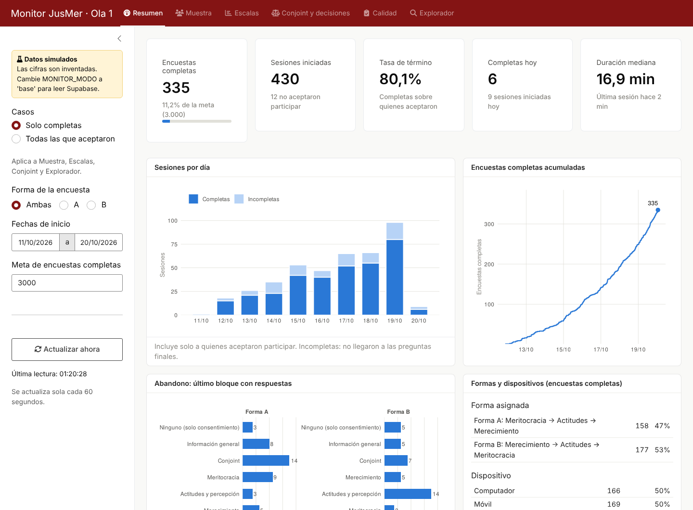

# Monitor de respuestas · Encuesta JusMer, Ola 1

Aplicación Shiny para seguir el trabajo de campo de la Ola 1 de la encuesta del proyecto Fondecyt N° 1250518 *Market Justice and Deservingness of Social Welfare* ([jus-mer/survey-jusmer](https://github.com/jus-mer/survey-jusmer), carpeta `surveys/ola1`). Muestra el avance del campo y los descriptivos básicos de las variables principales a medida que entran las respuestas.

La app es independiente de la encuesta: **solo lee** la tabla de respuestas y nunca escribe en ella.



## Estado actual

La app funciona por ahora con **datos simulados** (modo `demo`), con la misma estructura de columnas que la tabla de respuestas que surveydown escribe en Supabase (`jusmer_ola1_responses`). Las cifras de ese modo son inventadas y sirven solo para revisar el diseño. El modo `base` lee la base real; la conexión ya se probó con las credenciales de la encuesta (35 sesiones al 20-10-2026).

## Verla en el computador

```r
install.packages(c("shiny", "bslib", "dplyr", "ggplot2", "DT", "scales", "yaml"))
shiny::runApp()   # desde la carpeta del repositorio
```

## Qué muestra

| Pestaña | Contenido |
|---|---|
| **Resumen** | Encuestas completas y avance respecto de la meta, sesiones iniciadas, tasa de término, completas del día, duración mediana, sesiones por día, curva acumulada, abandono según el último bloque con respuestas (por forma A/B), formas y dispositivos. |
| **Muestra** | Sexo, edad y nivel educativo contra el marco de cuotas; nivel educativo, ingreso, estatus subjetivo, posición política, situación económica, identidad de género, sistema de salud y tipo de colegio. |
| **Escalas** | Barras apiladas y tabla (N, media, DE, % alto, % No sé, % Prefiero no responder) para Justicia de mercado, Lucro, Merecimiento, Meritocracia e Inseguridad económica. |
| **Conjoint y decisiones** | Reparto del monto en las seis tareas, consistencia de la tarea repetida (práctica y tarea 6 con lados invertidos), decisiones de pago (`dec_1` a `dec_3`) y prioridades de inversión pública. |
| **Calidad** | Chequeo de atención, comprensión de la tarea conjoint, respuestas muy rápidas, respuesta idéntica en la batería de merecimiento, exceso de No sé / No responde, duración e ítems con más No sé y Prefiero no responder. |
| **Explorador** | Frecuencias de cualquier variable del cuestionario, con sus etiquetas. |

La barra lateral permite filtrar por casos (solo completas o todas las que aceptaron), forma de la encuesta y fechas, y ajustar la meta. La app vuelve a leer los datos cada 60 segundos y también con el botón **Actualizar ahora**.

### Definiciones

- **Completa**: aceptó el consentimiento y respondió alguna de las preguntas finales (`salud_prov`, `educ_prov`). Se definen en `VARS_FIN` (`R/config.R`).
- **Abandono**: para las sesiones incompletas, el bloque más avanzado con alguna respuesta, según el orden de módulos de su forma (A: Meritocracia, Actitudes, Merecimiento; B: Merecimiento, Actitudes, Meritocracia).
- **Sliders con "Prefiero no responder"**: si la casilla `<id>_nr` está marcada, el valor del slider no se considera.
- **Tarea repetida**: la tarea 6 muestra los perfiles de la práctica con los lados invertidos; una respuesta consistente cumple práctica + tarea 6 ≈ $2.000.000 (tolerancia de $200.000).
- **Respuestas muy rápidas**: duración menor a un tercio de la mediana.
- Los umbrales de los indicadores de calidad (`UMBRALES_CALIDAD`) son referenciales y pueden ajustarse.
- El **marco de cuotas** (`MARCO_CUOTAS`) se copió de `output/monitoreo_cuotas/app.R` del pre-piloto: conviene confirmar que corresponde al diseño de la Ola 1.

## Estructura

```
monitor-jusmer/
├── app.R               interfaz y servidor
├── R/
│   ├── config.R        bloques, módulos, etiquetas breves, cuotas, umbrales
│   ├── preguntas.R     lectura de config/questions.yml
│   ├── datos.R         fuente de datos: demo o base
│   ├── simular.R       generador de respuestas simuladas
│   ├── procesar.R      variables derivadas y descriptivos
│   └── graficos.R      gráficos (ggplot2)
├── config/
│   └── questions.yml   copia de surveys/ola1/_survey/questions.yml
├── docs/capturas/      capturas de pantalla
└── .env.example        plantilla de credenciales (el .env real no se sube)
```

Si cambia el cuestionario: copiar de nuevo `surveys/ola1/_survey/questions.yml` a `config/questions.yml` y ajustar las listas de `R/config.R` (bloques, módulos y etiquetas breves).

## Conexión en vivo con Supabase

La encuesta guarda cada respuesta en la tabla `jusmer_ola1_responses` de Supabase (Postgres) y la va actualizando a medida que la persona avanza. El monitor consulta esa misma tabla directamente, así que **no hay que descargar datos**: cada lectura trae el estado actual del campo, incluidas las sesiones en curso. Solo se leen las columnas necesarias (se excluyen `ip_address`, `cbc_profiles`, los `*_hist` y los `time_q_*`).

### 1. Crear un usuario de solo lectura

Se recomienda no reutilizar las credenciales de la encuesta (que pueden escribir). En el SQL Editor de Supabase:

```sql
create role monitor_lectura with login password 'UNA-CLAVE-LARGA';
grant usage on schema public to monitor_lectura;
grant select on public.jusmer_ola1_responses to monitor_lectura;

-- Si la tabla tiene Row Level Security activado, el rol necesita además
-- una política que le permita leer:
create policy "monitor solo lectura" on public.jusmer_ola1_responses
  for select to monitor_lectura using (true);
```

### 2. Credenciales

Copiar `.env.example` a `.env` y completar los datos que aparecen en Supabase en **Connect** (transaction pooler), con el usuario de solo lectura:

```
MONITOR_MODO=base
SD_HOST=aws-0-xx-xxxx-x.pooler.supabase.com
SD_PORT=6543
SD_DBNAME=postgres
SD_USER=monitor_lectura.<project-ref>
SD_PASSWORD=UNA-CLAVE-LARGA
SD_TABLE=jusmer_ola1_responses
```

Con el pooler de Supabase, el usuario suele llevar el identificador del proyecto (`rol.<project-ref>`, igual que `postgres.<project-ref>`); conviene confirmarlo en el panel de conexión. El `.env` está en `.gitignore` y no debe subirse al repositorio.

Instalar además `DBI` y `RPostgres`:

```r
install.packages(c("DBI", "RPostgres"))
```

### 3. Desplegar en Posit Connect Cloud

Igual que la encuesta (`surveys/ola1/POSIT_CLOUD.md`): desde la carpeta del repositorio,

```r
readRenviron(".env")   # carga las credenciales en la sesión para subirlas como secretos
rsconnect::deployApp(appName = "monitor-ola1", appTitle = "Monitor JusMer · Ola 1",
                     appFiles = c("app.R", "R", "config"), envVars = c(
                       "MONITOR_MODO", "SD_HOST", "SD_PORT", "SD_DBNAME",
                       "SD_USER", "SD_PASSWORD", "SD_TABLE"))
```

Si hay más de una cuenta registrada en `rsconnect`, agregar `server = "connect.posit.cloud"`. Las variables se suben como secretos del contenido y no quedan en los archivos. Como el monitor muestra datos del campo, conviene dejar el acceso del contenido como **privado** (solo el equipo) en la configuración de Connect Cloud. En el plan gratuito, este despliegue ocupa uno de los cupos de aplicaciones.

Variables opcionales: `MONITOR_META_N` (meta de completas, por defecto 3000) y `MONITOR_REFRESCO_SEG` (segundos entre lecturas, por defecto 60).
